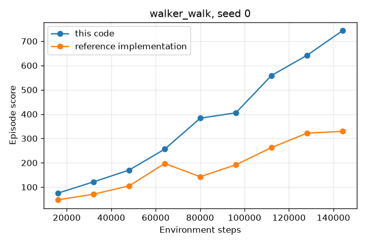

# Dreamer

This repository contains a small implementation of
[DreamerV3](https://arxiv.org/abs/2301.04104) in JAX. The neural networks use
[Flax NNX](https://flax.readthedocs.io/). The code supports one task family:
the DeepMind Control walker with proprioceptive observations.

The goal of this code is to teach. Each commit adds one part of the algorithm,
with tests that show what the part does. Read the commits in order:

```sh
git log --reverse --oneline
```

The hyperparameters and the algorithm agree with the `dmc_proprio` settings
of the [reference implementation](https://github.com/danijar/dreamerv3).

## Read the code

Read the files in this order. Each file has a test file in `tests/` with the
same topic. The tests show the behavior of each part, so read them together
with the code.

| File | Contents | Paper section |
| --- | --- | --- |
| `envs.py` | The walker task and the format of a step: `is_first`, `is_last`, `is_terminal`. A runner that resets each environment after its last step. | |
| `replay.py` | The replay buffer of sequences, with the online queue and the stored RSSM states. | Experience replay |
| `symlog.py` | The symlog transform for targets of any scale. | Robust predictions |
| `distributions.py` | Two-hot regression, categorical latents with unimix, the policy distribution. | Robust predictions, Distributions |
| `layers.py` | Linear layers with RMSNorm and SiLU, and block-diagonal layers. | Networks |
| `rssm.py` | The recurrent state-space model and its KL losses with free bits. | World model learning |
| `world_model.py` | The encoder, the decoder, the reward and continue heads, and the world model loss. | World model learning |
| `actor_critic.py` | λ-returns, return normalization, the actor, the critic, and their losses. | Critic learning, Actor learning |
| `optim.py` | Adaptive gradient clipping and the LaProp optimizer. | Optimizer |
| `agent.py` | One training step, and the policy in the environment. | |
| `config.py` | The hyperparameters. | Hyperparameters |
| `train.py` | The training loop. | |

## One training step

```text
batch = replay.sample()                 16 sequences of 1 + 64 steps
start = batch.state[:, 0]               the replay context: the stored state
states = rssm.observe(start, batch)     the posterior states of 64 steps

World model losses (scale):
  dyn (1.0)   KL(sg(posterior) || prior), at least 1 nat
  rep (0.1)   KL(posterior || sg(prior)), at least 1 nat
  rec (1.0)   symlog squared error of the observations
  rew (1.0)   two-hot loss of the rewards
  con (1.0)   cross-entropy of the discount targets 0.997 or 0

Imagination from each of the 16 x 64 posterior states, for 15 steps:
  returns = λ-returns of the predicted rewards and critic values
  policy (1.0)   REINFORCE with advantage / max(1, P95 - P5) and an entropy bonus
  value  (1.0)   two-hot loss to the returns, and to the slow critic

Replay value loss:
  repval (0.3)   two-hot loss to the λ-returns of the real rewards

One LaProp step on the sum of the losses. The slow critic moves 2% toward
the critic. The replay buffer keeps the new posterior states.
```

## Install

Use Python 3.12 or later.

```sh
uv venv -p 3.12
uv pip install -e '.[test]'        # CPU only
uv pip install -e '.[cuda,test]'   # NVIDIA GPU
```

## Test

```sh
pytest
```

The tests run on the CPU and use small models. The first run compiles many
small programs and takes about a minute. JAX keeps the compiled programs in a
cache, so the next runs are faster.

## Train

```sh
python -m dreamer.train --task walker_walk --logdir ~/logdir/walker_walk
python -m dreamer.train --help
```

On one RTX A5000 GPU, the agent does about 46 environment steps per second,
so a run of 150K steps takes about 1 hour. The log directory gets
`metrics.jsonl` with the training metrics, and `scores.jsonl` with the score
of each episode. To plot the scores:

```sh
uv pip install -e '.[plot]'
python scripts/plot.py ~/logdir/walker_walk/scores.jsonl --out scores.png
```

## Results

The plot shows one run of 150K environment steps on `walker_walk` with seed
0. The reference run uses the `dmc_proprio` settings of the reference
implementation, ported to JAX 0.11, on the same GPU.



| Environment steps | This code | Reference implementation | Paper: mean (range) of 5 seeds |
| --- | --- | --- | --- |
| 48K | 170 | 105 | 289 (206 to 448) at 50K |
| 96K | 405 | 192 | 475 (298 to 714) at 100K |
| 144K | 743 | 329 | 738 (472 to 951) at 150K |

One seed is not sufficient to compare the two implementations. The result
shows that this code learns the task as fast as the runs of the paper. The
reference run is below the paper runs. More seeds are necessary to find the
cause.

The speed on the same GPU, without other processes:

| | This code | Reference implementation |
| --- | --- | --- |
| Training step, 16 x 64 steps | 18.1 ms | 18.8 ms |
| Policy step, 16 environments | 4.1 ms | 8.2 ms |

With float32 instead of bfloat16, the training step of this code takes
19.7 ms. The model is small, so bfloat16 gives only a small gain.

The `results/` folder has the scores of both runs. This command makes the
plot again:

```sh
python scripts/plot.py results/scores_this_code.jsonl \
    results/scores_reference.jsonl --labels "this code" "reference implementation" \
    --title "walker_walk, seed 0" --out results/walker_walk.png
```

The run of this code used the commit "Add bfloat16 compute", which comes
before `scores.jsonl`. That commit logs the mean score of each log interval.
The scores file puts each mean at the step where its episodes ended.

## Differences from the reference implementation

The algorithm and the hyperparameters are the same. These parts are different:

- The environments run in lockstep in the training process. The reference can
  run them in separate processes.
- There are no checkpoints, no evaluation episodes, and no video reports.
- The code supports vector observations only. The reference also has a
  convolutional encoder and decoder for images.
- The decoder has one output layer for all observation vectors, and the
  reference has one layer for each vector. The two give the same loss and the
  same distribution of initial weights.
- The replay buffer keeps the steps in one array for each environment. The
  reference keeps them in chunks, and can save them to disk.
- The code logs fewer metrics.
